# Visual-Inertial SLAM With an Extended Kalman Filter

Jointly estimating a vehicle's 3D trajectory and a map of static landmarks by fusing IMU motion with stereo camera features, using an extended Kalman filter on SE(3).

📄 Full write-up: [ECE276A_PR3_Report.pdf](ECE276A_PR3_Report.pdf) (UCSD ECE276A, Project 3)

<table>
  <tr>
    <td>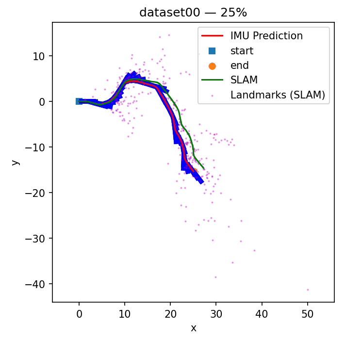</td>
    <td></td>
    <td>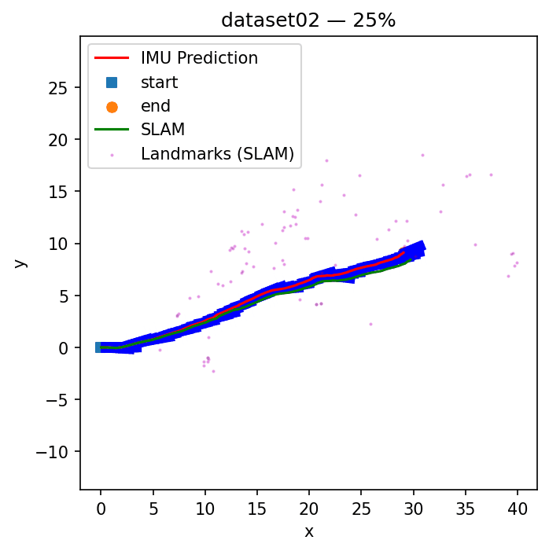</td>
  </tr>
  <tr>
    <td align="center"><sub>Dataset 00</sub></td>
    <td align="center"><sub>Dataset 01</sub></td>
    <td align="center"><sub>Dataset 02 (features detected and tracked from raw images)</sub></td>
  </tr>
</table>

<sub>Each GIF steps through the run at 25%, 50%, 75% and 100%. <b>Red</b>: IMU-only dead reckoning. <b>Green</b>: VI-SLAM trajectory. <b>Magenta</b>: estimated landmark positions. <b>Blue ticks</b>: heading along the IMU path.</sub>

## Overview

An IMU alone can estimate motion by integrating velocity measurements, but small errors accumulate and the estimate drifts without bound. A stereo camera can see fixed points in the world, but its measurements are noisy, often incomplete because of occlusion and bad matches, and say nothing about motion between frames. This project combines the two. The IMU predicts how the vehicle moved, and repeated stereo observations of the same static landmarks correct that prediction. At the same time, the filter builds a 3D map of those landmarks.

The pipeline:

1. **Predict** the vehicle pose by integrating IMU linear and angular velocity on SE(3).
2. **Detect and track** visual features across time and across the stereo pair.
3. **Filter out** features that are unstable or moving (e.g. pedestrians) so the static-world assumption holds.
4. **Triangulate** new landmarks from stereo disparity.
5. **Update** the pose and every observed landmark together in a single EKF correction step.

## Method

**IMU prediction on SE(3).** The pose is a 4×4 rigid-body transform $T_t \in SE(3)$, propagated with the IMU's generalized velocity $u_t = [v_t, \omega_t]$:

$$\mu_{t+1} = \mu_t \exp(\Delta\tau_t\,\hat{u}_t), \qquad \Sigma_{t+1} = e^{-\Delta\tau_t \check{u}_t}\,\Sigma_t\,e^{-\Delta\tau_t \check{u}_t\,\top} + \Delta\tau_t W$$

Uncertainty is tracked as a 6-D perturbation in the Lie algebra, so the mean always stays a valid pose.

**Feature detection and tracking.** For dataset 02 the stereo feature tracks were generated from the raw images rather than supplied:

- Shi-Tomasi corners are detected in the left image.
- Pyramidal Lucas-Kanade optical flow tracks the corners frame to frame.
- The same optical flow matches each left-image point to the right image.
- New corners are added whenever fewer than 100 tracks remain.

**Dynamic-landmark filtering.** The EKF assumes landmarks don't move, so tracks that violate this are removed before filtering:

- A track is dropped if it is seen in fewer than 5 frames.
- A track is dropped if it is closer than 1 m or farther than 15 m.
- A track is also dropped if, when triangulated from two observations at least 2 s apart, its two world positions differ by more than 0.5 m. This rejects moving objects.

**Stereo observation model.** Each landmark $m_j$ projects into both cameras through the stereo calibration matrix $K_s$:

$$z_{t,j} = K_s\,\pi\!\left({}_OT_I\,T_t^{-1} m_j\right) + v_{t,j}$$

New landmarks are initialized by triangulating the left-right disparity, and points with implausible depth are rejected.

**Joint EKF update.** The state contains the current pose and a sampled subset of the filtered landmarks (60%, with at least 1,200 kept so the problem stays tractable). Its covariance is stored as a sparse matrix. Each correction step:

- computes Jacobians of the observation with respect to both the pose and the landmarks;
- applies the pose correction on SE(3) through the exponential map, and the landmark correction additively;
- discards residuals of 15 px or more, to avoid over-correcting on bad matches;
- updates the covariance in **Joseph form** and re-symmetrizes it, for numerical stability.

## Results

### Final trajectories and maps

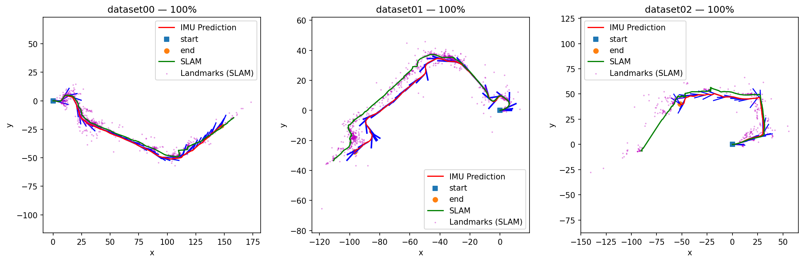

- **Dataset 00.** VI-SLAM and IMU agree closely along the whole route. Landmarks cluster tightly along the path, which is what you'd expect from a well-behaved filter on a mostly smooth drive.
- **Dataset 01.** On the long return leg, the visual corrections pull the trajectory measurably away from dead reckoning. The landmark map becomes dense near turns, where many static features are visible.
- **Dataset 02.** This run uses features the pipeline detected and tracked itself. SLAM follows the overall loop, but on the final segment it veers off from the IMU estimate where the tracked features become very sparse.

### Progression snapshots

<details>
<summary>All snapshots at 25 / 50 / 75 / 100% for each dataset</summary>

| | 25% | 50% | 75% | 100% |
|:-:|:-:|:-:|:-:|:-:|
| **00** | 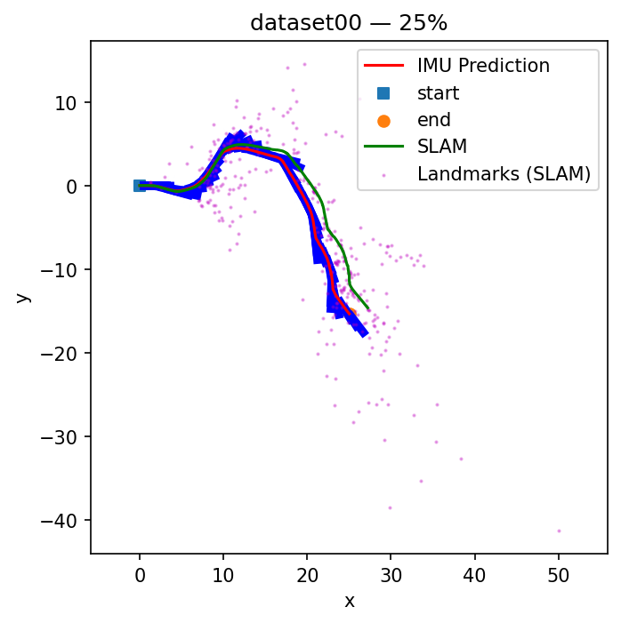 | 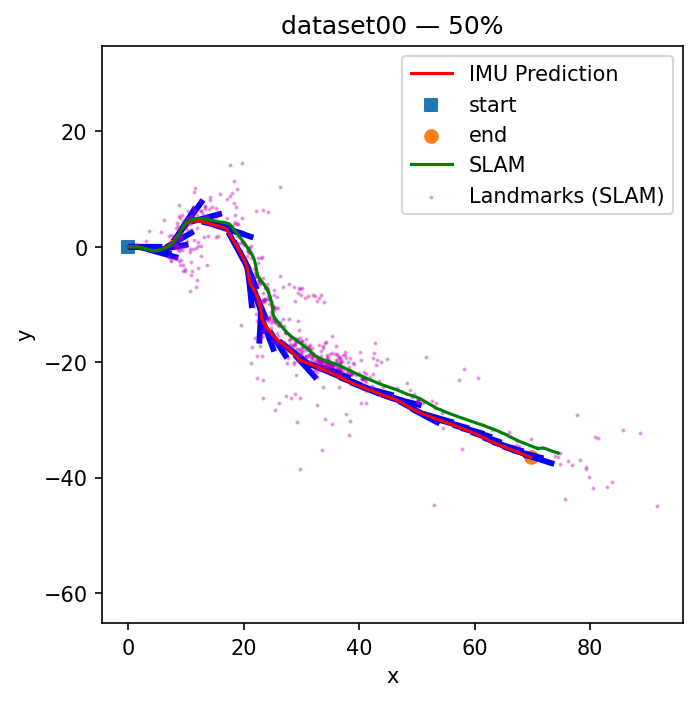 | 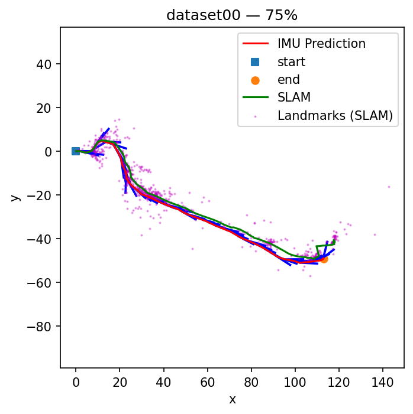 | 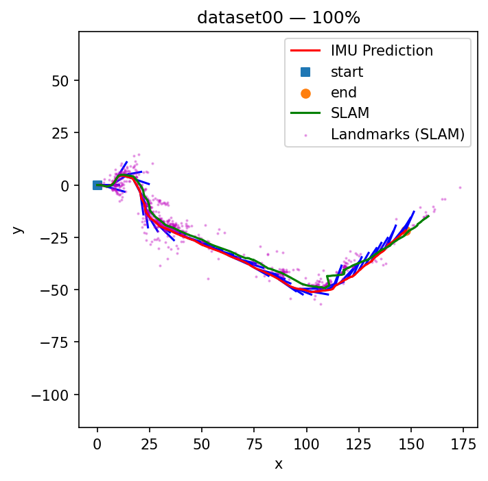 |
| **01** | 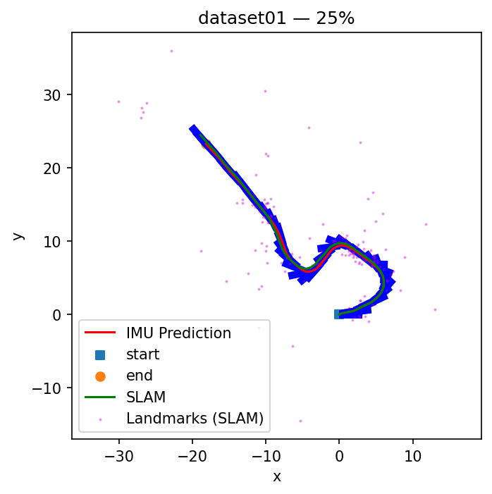 | 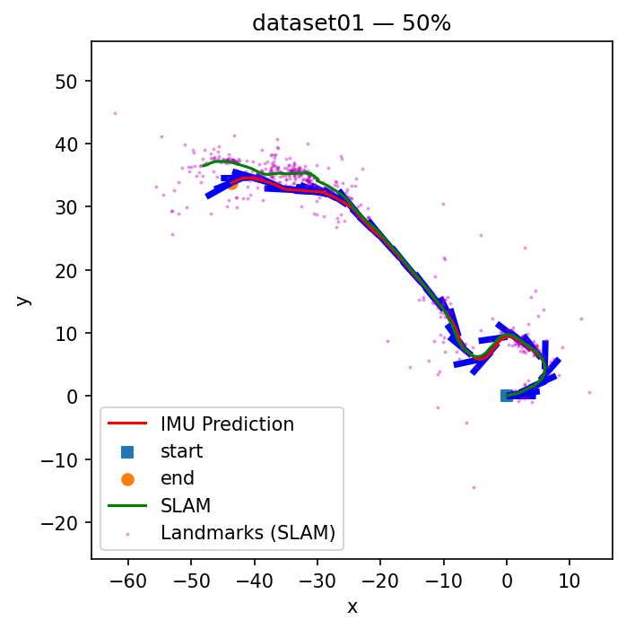 | 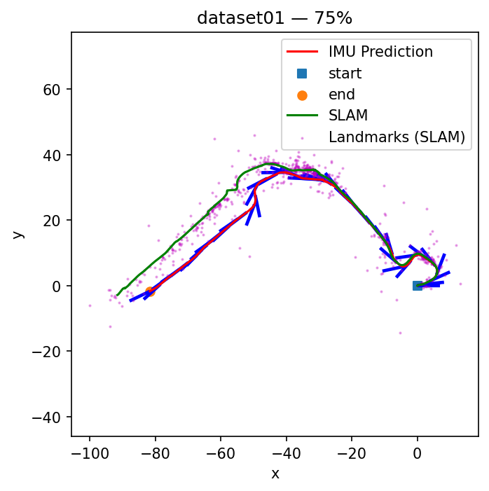 | 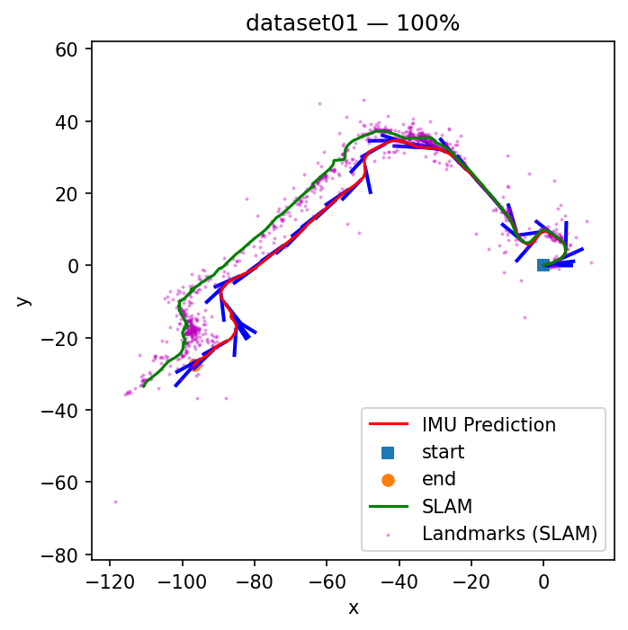 |
| **02** |  | 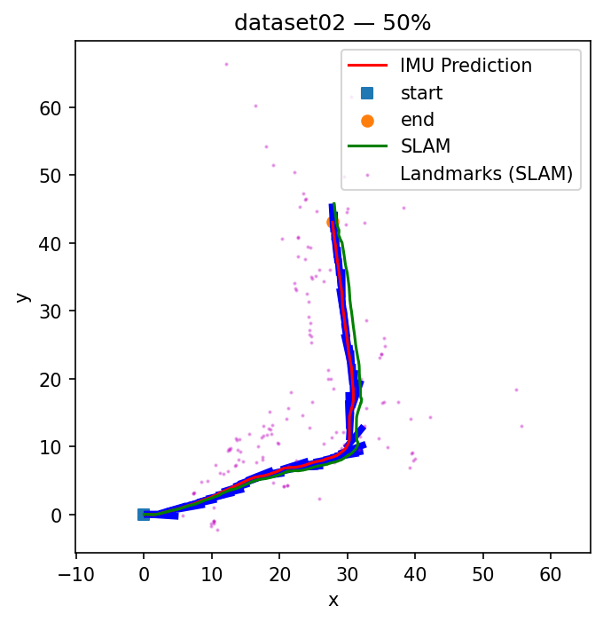 | 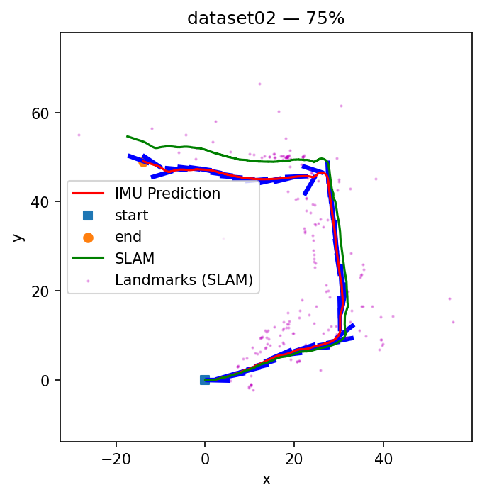 | 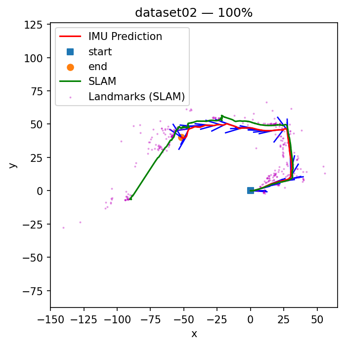 |

</details>

## Takeaways

- **Rejecting moving features mattered most for the map.** Some raw tracks were on moving people. Removing tracks whose triangulated position shifts over time noticeably cleaned up the map.
- **Trust the IMU more than the landmarks.** The vehicle moves smoothly on flat ground, so the IMU prior is reliable. Distant or unstable landmarks are not. Raising the observation noise and lowering the IMU noise gave the best trajectory corrections.
- **Joseph-form updates kept the covariance stable.** Together with re-symmetrization, this stopped the joint covariance from growing too quickly or becoming ill-conditioned.
- **Stereo triangulation was more reliable than bearing-only triangulation**, which consistently disagreed with the stereo estimates.
- **Remaining limitations.** The trajectory still shows jagged corrections. Their likely source is a few poorly triangulated landmarks getting past the filters and pulling the update off course, which IMU drift then amplifies. Where features are sparse (end of dataset 02), the estimate can drift. Stronger outlier rejection or loop closure would be natural next steps.

## Repository Layout

```
ECE276A_PR3_Report.pdf   full technical report (derivations, parameters, discussion)
results/final_maps.png   final trajectory + landmark map for all three datasets
results/gifs/            per-dataset animation of the map building up over the run
results/snapshots/       individual snapshots at 25 / 50 / 75 / 100% of each run
```

## License

[MIT](LICENSE)
